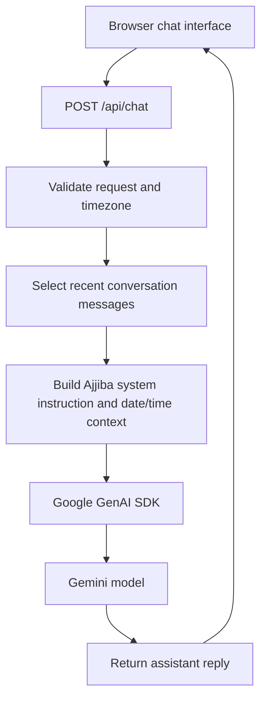

# Ajjiba AI — Architecture Notes

This document describes the current high-level implementation. It is intentionally limited to behavior present in the repository today.

## Request flow

## Main application areas

| Path | Responsibility |
|---|---|
| `src/app/page.js` | Main chat interface and browser-side conversation management |
| `src/app/api/chat/route.js` | Server-side chat endpoint and Gemini integration |
| `src/app/layout.js` | Root application layout |
| `src/app/globals.css` | Global styles |
| `public/ajjiba-avatar.webp` | Ajjiba avatar asset |
| `public/ajjiba-logo-dark.png` | Ajjiba logo asset |

## Chat API behavior

The current chat endpoint:

- Runs on the Node.js runtime.
- Reads `GEMINI_API_KEY` and `GEMINI_MODEL` from server environment variables.
- Accepts a conversation message array and optional IANA timezone.
- Uses Asia/Kolkata when no timezone is supplied.
- Adds current date/time context to Ajjiba's system instruction.
- Maps assistant messages to Gemini's `model` role.
- Sends a bounded recent message history to Gemini.
- Returns a generated reply or an error response.

The implementation is still being hardened. See the Phase 1 section of [the roadmap](ROADMAP.md) for planned validation, context, and testing improvements.

## Conversation storage

The current interface stores conversations in browser local storage. This supports persistence after a refresh in the same browser profile, but it is not a server-side database and does not synchronize conversations across devices.

## Security boundaries

- Gemini credentials belong in server-side environment variables.
- Do not use a `NEXT_PUBLIC_` prefix for the Gemini API key.
- Keep `.env.local` out of version control.
- Treat client-submitted messages and timezone values as untrusted input.
- Do not log secrets or sensitive conversation content unnecessarily.

## Deployment

The production application is hosted at [ajjiba-ai.vercel.app](https://ajjiba-ai.vercel.app/). The GitHub `main` branch is connected to Vercel production deployments.
